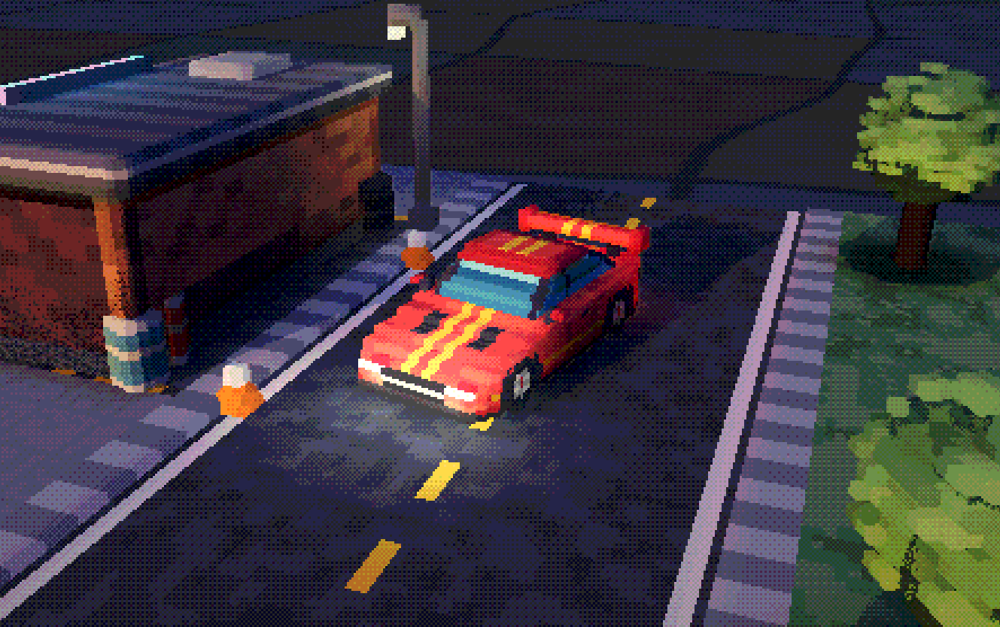

# Le'Vox

**Crie mundos, personagens e jogos 3D em pixel art rodando direto no navegador — ou exporte tudo em `.GLB` para usar no Blender, Godot e Unreal.**

O **Le'Vox** é um motor gráfico leve e uma **Skill pronta para agentes de IA** (Hermes, Claude Code, Codex, Cursor, etc.). Você descreve o que quer em português para o seu agente, e ele monta cenas 3D em pixel art nítida, com iluminação dinâmica, sombras, dither retrô e personagens que andam — sem precisar instalar engine pesada nem depender de placa de vídeo dedicada.

---

## O que dá para fazer (prints reais dos demos)

> Todos esses testes rodam **direto no navegador** abrindo o arquivo `index.html` (sem servidor, sem build, até sem GPU dedicada).

| Garagem TURBO-86 (Diorama + Bayer Dither) | Queda Oceanic 815 (Bullet-Time no Ar) |
| :---: | :---: |
|  |  |
| Carro retrô, garagem oca com corte de teto, postes com luz noturna e efeito de "impressora 3D" camada por camada. | Avião partido ao meio congelado no ar com rotação 3D (`pitch`/`roll`), fogo animado e controle de câmera/tempo. |

---

## Como funciona (sem complicação)

Em vez de modelar polígonos complexos ou depender de IAs pesadas de geração 3D, o **Le'Vox** usa **Sprite Stacking** (empilhamento de fatias 2D, tipo uma impressora 3D):

1. Cada objeto é fatiado em camadas horizontais (do chão até o topo).
2. O motor desenha essas camadas em WebGL2 com **luz do sol, sombras, oclusão ambiente, até 32 lâmpadas, neblina e filtro pixelado com Bayer Dither + outline**.
3. Como tudo é descrito em **blocos simples** (caixas, cilindros, rampas, cúpulas, furos) ou **peças prontas** (carros, casas, árvores, mesas, personagens), **qualquer agente de IA consegue criar e editar cenas 3D barato e sem quebrar a geometria**.
4. Gostou do objeto ou cenário? Com 1 chamada ele exporta a malha otimizada em **`.glb`** (com cores e luzes emissivas prontas) para abrir direto no **Blender, Godot, Unity ou Unreal**.

---

## Como usar com seu Agente de IA (Vibecoding)

### 1. Instale a Skill no seu agente

Se você usa CLI compatível com o padrão Agent Skills:

```bash
npx skills add leonmachado91/le-vox
```

Ou copie a pasta pronta **`dist/le-vox-skill/`** (ou `.agents/skills/le-vox/`) para dentro da pasta de skills do seu agente (ex.: `~/.hermes/skills/le-vox/` ou `~/.claude/skills/le-vox/`), mantendo o nome `le-vox`.

> A pasta da skill já vem **100% independente**: ela traz o motor inteiro em um único arquivo (`assets/le-vox.js`), o manual (`SKILL.md` + `references/scene-schema.md`) e o script de fatiar imagens (`scripts/views_to_slices.py`). Seu agente consegue criar projetos em **qualquer pasta do seu computador**, sem depender deste repositório.

### 2. Exemplos de pedidos que você pode fazer para a IA

* *"Usando a skill `le-vox`, cria um HTML offline de uma cafeteria cyberpunk à noite com letreiro brilhando, mesas, árvores e um personagem andando."*
* *"Usa o `le-vox` para fazer um mini-jogo isométrico onde um robô desvia de drones e atira lasers."*
* *"Modela uma nave espacial estilo pixel art via DSL no `le-vox` e já exporta ela em `.glb` para eu abrir no Godot."*

---

## Quer testar os demos agora no navegador?

1. Clone ou baixe este repositório.
2. Abra direto no Chrome/Edge/Firefox (duplo clique no arquivo):
   * `core/verify.html` — cena completa com controles de hora do dia, inclinação, dither e botão **Exportar Cena (.GLB)**.
   * `scenes/turbo86-garage/index.html` — garagem retrô (`Z` imprime em 3D camada por camada, `X` explode as peças).
   * `scenes/lost-crash/index.html` — cena bullet-time com câmeras (`1–4`) e controle do tempo.
   * `scenes/neon-arena/index.html` — jogo de tiro isométrico (`WASD` + mouse + `Espaço`).

> **Dica se o seu PC não tiver GPU dedicada:** todas as cenas já abrem leves em modo pixel (`scale = 3` + Voxel Mode).

---

## O que tem dentro do repositório (para quem quiser fuçar)

* `core/` — Motor WebGL2 modular (`engine.js`, `art.js`, `rig.js`, `dsl.js`, `importers.js`, `exporters.js`, `studio.js`).
* `prefabs/` — Modelos prontos e recoloríveis (carro `coupe`, avião `airlinerHalf`, casa `brickHouse`, poste, árvores, pedras, estação de PC, caixas, barris e personagem `humanoid`).
* `dist/le-vox.js` — Arquivo único compilado (~123 KB) com tudo junto, zero dependências.
* `dist/le-vox-skill/` — Pasta pronta da Skill para copiar ou distribuir.
* `scripts/` — `build_dist.mjs` (empacota tudo) e `views_to_slices.py` (converte sprites 2D de 4 vistas em fatias empilháveis usando Python + Pillow/NumPy).
* `tests/` — Testes automatizados (`node --test tests/*.mjs`).

### Rodar build e testes localmente

```bash
node scripts/build_dist.mjs
node --test tests/*.mjs
```

---

## Créditos e Licença

Projeto sob licença **MIT** (`LICENSE`), construído sobre técnicas e código-base MIT de:
* [`loktar00/sprite-stack-engine`](https://github.com/loktar00/sprite-stack-engine) — renderizador WebGL2 de fatias/voxels e iluminação diferida.
* [`danielwh2/sprite-stacking`](https://github.com/danielwh2/sprite-stacking) — script `views_to_slices.py` para fatiamento a partir de 4 vistas ortográficas.
